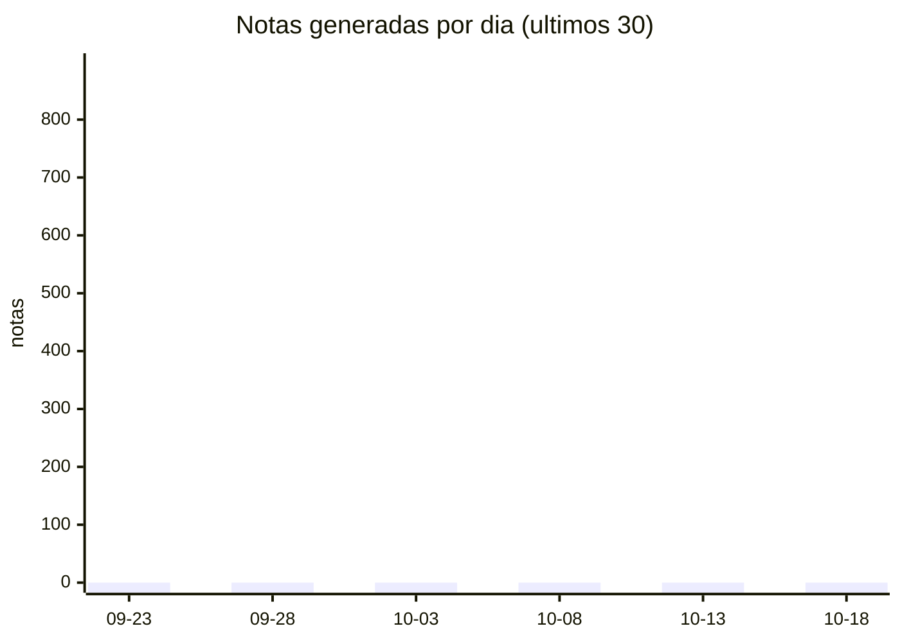

<!-- generado por tablero.py. No editar a mano. -->

# Tablero

Actualizado: 2026-10-22 06:04:44

## Estado

- Pipeline: **parado**
- Ultimo resultado: sin datos
- Incidencias abiertas: **0**
- Notas totales: **1547** | esta semana: 1547 | hoy: 198
- Skills: 17

## Actividad

### Por etapa

- aprendizaje: 976
- aprendizaje-web: 569
- skills: 1
- inicializacion: 1

### Por origen

- local: 1547

## Temas principales

- [[WebAssembly Streaming]] (8)
- [[PostgreSQL Indexes]] (8)
- [[React Server Components]] (8)
- [[Temporal Workflow Engine]] (7)
- [[Temporal Cloud Native]] (7)
- [[Temporal Activity Patterns]] (7)
- [[Temporal Event Sourcing]] (7)
- [[gRPC Protobuf]] (7)
- [[Terraform Infrastructure as Code]] (7)
- [[Tracing OpenTelemetry]] (7)
- [[gRPC Protocols]] (7)
- [[Rust Async Runtime]] (7)
- [[Docker Compose]] (7)
- [[Helm Charts Management]] (6)
- [[Kafka Schema Registry]] (6)
- [[Terraform Sentinel Custom Rules]] (6)
- [[Git Hooks]] (6)
- [[GraphQL Federation]] (6)
- [[Kubernetes Operators]] (6)
- [[PostgreSQL Connection Pooling]] (6)

## Rendimiento (hoy)

- Archivos procesados: 0 (ok 0, fallos 0)
- Tiempo total: 0s

## Notas recientes

- 2026-10-22 · [[LLM-Memoria/Web/arxiv/A-Composite-Design-Pattern-for-Service-Injection-and-Composi-cae698|A-Composite-Design-Pattern-for-Service-Injection-and-Composi-cae698]]
- 2026-10-22 · [[LLM-Memoria/Web/arxiv/A-Methodology-for-Selecting-and-Composing-Runtime-Architectu-b28914|A-Methodology-for-Selecting-and-Composing-Runtime-Architectu-b28914]]
- 2026-10-22 · [[LLM-Memoria/Web/arxiv/A-Neutral-Temporal-Deontic-STIT-Logic-5cd205|A-Neutral-Temporal-Deontic-STIT-Logic-5cd205]]
- 2026-10-22 · [[LLM-Memoria/Web/arxiv/Adaptation-of-TURN-protocol-to-SIP-protocol-25d69c|Adaptation-of-TURN-protocol-to-SIP-protocol-25d69c]]
- 2026-10-22 · [[LLM-Memoria/Web/arxiv/An-SLO-Driven-and-Cost-Aware-Autoscaling-Framework-for-Kuber-807a04|An-SLO-Driven-and-Cost-Aware-Autoscaling-Framework-for-Kuber-807a04]]
- 2026-10-22 · [[LLM-Memoria/Web/arxiv/Annotative-Indexing-3f6953|Annotative-Indexing-3f6953]]
- 2026-10-22 · [[LLM-Memoria/Web/arxiv/Benchmarking-Apache-Arrow-Flight-A-wire-speed-protocol-for-d-7681f7|Benchmarking-Apache-Arrow-Flight-A-wire-speed-protocol-for-d-7681f7]]
- 2026-10-22 · [[LLM-Memoria/Web/arxiv/BigFoot-Exploiting-and-Mitigating-Leakage-in-Encrypted-Write-92d2ce|BigFoot-Exploiting-and-Mitigating-Leakage-in-Encrypted-Write-92d2ce]]
- 2026-10-22 · [[LLM-Memoria/Web/arxiv/Byzantine-Resilient-SGD-in-High-Dimensions-on-Heterogeneous--4c6edb|Byzantine-Resilient-SGD-in-High-Dimensions-on-Heterogeneous--4c6edb]]
- 2026-10-22 · [[LLM-Memoria/Web/arxiv/Caching-with-rental-cost-and-zapping-ca8a79|Caching-with-rental-cost-and-zapping-ca8a79]]
- 2026-10-22 · [[LLM-Memoria/Web/arxiv/Comparison-between-illumination-model-and-hydrodynamic-simul-c8a2d5|Comparison-between-illumination-model-and-hydrodynamic-simul-c8a2d5]]
- 2026-10-22 · [[LLM-Memoria/Web/arxiv/Data-Encoding-for-Byzantine-Resilient-Distributed-Optimizati-c0ff4b|Data-Encoding-for-Byzantine-Resilient-Distributed-Optimizati-c0ff4b]]
- 2026-10-22 · [[LLM-Memoria/Web/arxiv/Detecting-coalitions-by-optimally-partitioning-signed-networ-d0a49e|Detecting-coalitions-by-optimally-partitioning-signed-networ-d0a49e]]
- 2026-10-22 · [[LLM-Memoria/Web/arxiv/Developing-a-Resource-Constraint-EdgeAI-model-for-Surface-De-b3cbfa|Developing-a-Resource-Constraint-EdgeAI-model-for-Surface-De-b3cbfa]]
- 2026-10-22 · [[LLM-Memoria/Web/arxiv/Dynamic-cache-reconfiguration-based-techniques-for-improving-297c28|Dynamic-cache-reconfiguration-based-techniques-for-improving-297c28]]
- 2026-10-22 · [[LLM-Memoria/Web/arxiv/Efficient-Fault-Tolerance-for-Pipelined-Query-Engines-via-Wr-cd100b|Efficient-Fault-Tolerance-for-Pipelined-Query-Engines-via-Wr-cd100b]]
- 2026-10-22 · [[LLM-Memoria/Web/arxiv/Experimental-Analysis-of-Server-Side-Caching-for-Web-Perform-1946f0|Experimental-Analysis-of-Server-Side-Caching-for-Web-Perform-1946f0]]
- 2026-10-22 · [[LLM-Memoria/Web/arxiv/Explainable-Machine-Learning-for-Public-Policy-Use-Cases-Gap-faaade|Explainable-Machine-Learning-for-Public-Policy-Use-Cases-Gap-faaade]]
- 2026-10-22 · [[LLM-Memoria/Web/arxiv/Federated-and-Transfer-Learning-A-Survey-on-Adversaries-and--f92af3|Federated-and-Transfer-Learning-A-Survey-on-Adversaries-and--f92af3]]
- 2026-10-22 · [[LLM-Memoria/Web/arxiv/Federated-Attention-Autoencoders-with-a-Stochastic-Aggregati-f7ff65|Federated-Attention-Autoencoders-with-a-Stochastic-Aggregati-f7ff65]]
- 2026-10-22 · [[LLM-Memoria/Web/arxiv/Fixation-probability-of-rare-nonmutator-and-evolution-of-mut-fc3f2e|Fixation-probability-of-rare-nonmutator-and-evolution-of-mut-fc3f2e]]
- 2026-10-22 · [[LLM-Memoria/Web/arxiv/Handling-Bidirectional-Control-Flow-Technical-Report-1996be|Handling-Bidirectional-Control-Flow-Technical-Report-1996be]]
- 2026-10-22 · [[LLM-Memoria/Web/arxiv/HDDL-2-1-Towards-Defining-a-Formalism-and-a-Semantics-for-Te-85b814|HDDL-2-1-Towards-Defining-a-Formalism-and-a-Semantics-for-Te-85b814]]
- 2026-10-22 · [[LLM-Memoria/Web/arxiv/Human-Robot-Navigation-using-Event-based-Cameras-and-Reinfor-8efa06|Human-Robot-Navigation-using-Event-based-Cameras-and-Reinfor-8efa06]]
- 2026-10-22 · [[LLM-Memoria/Web/arxiv/Impact-of-etcd-Deployment-on-Kubernetes-Istio-and-Applicatio-352e62|Impact-of-etcd-Deployment-on-Kubernetes-Istio-and-Applicatio-352e62]]

## Skills

- Decisiones
- agente-research-academico
- an-lisis-datos-excel-python-interactivo
- automatizaci-n-flujo-publicaci-n-con-tokens
- automatizaci-n-generaci-n-ppt-est-ndar
- automatizaci-n-ppt-generaci-n-est-ndar
- automatizacion-excel-python
- configuraci-n-mcp-agente-hermes
- configuracion-llm-local
- creaci-n-diagramas-arquitectura
- dise-o-diagramas-arquitectura-sistema
- dise-o-infograf-a-bento-grid
- dise-o-infografia-bento
- dise-o-web-landing-logistica
- estructura-database-perfiles-usuarios
- generacion-ppt-semantic
- gesti-n-inventario-costos-multi-sector

## Enlaces

- [[Huecos]] · [[Conocimiento]] · [[Revision/Cola]]
- [[AprendidoHoy]] · [[AprendidoSemana]]
